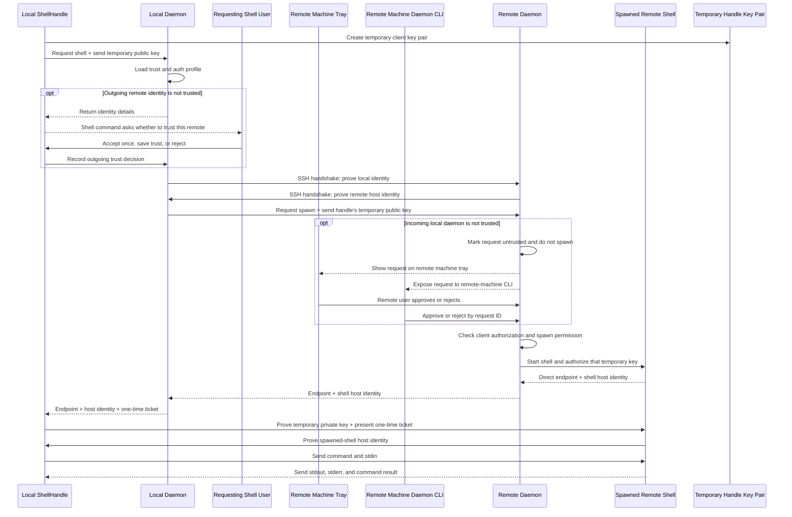
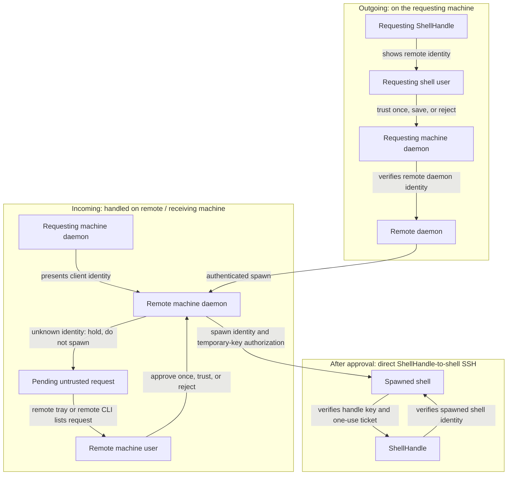
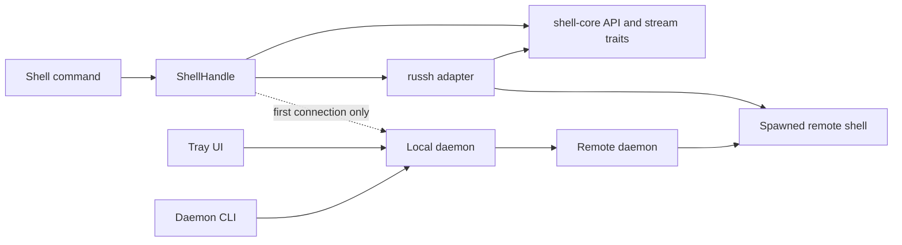
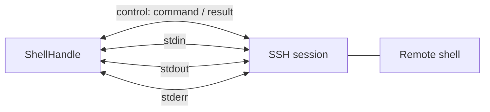

# A practical guide to remote shells

This is an implementation guide for adding secure remote shells. It follows
the design you described:

1. The daemon handles authentication and asks the remote daemon to start a
   shell.
2. The local `ShellHandle` connects directly to that new shell.
3. After that, the handle sends commands and receives output directly. The
   daemon is not in the command/data path.

The steps below are suggestions, not code you have to copy exactly. Build and
test one step at a time.

## The idea in one picture



The daemon is only involved in the first part: authenticate and ask the remote
daemon to start a shell. After that, the `ShellHandle` talks directly to its
remote shell. Outgoing trust is handled by the user at the requesting shell.
Incoming trust is handled on the remote machine, using that machine's tray or
daemon CLI. Neither UI relays commands or output.

Each computer makes its own trust decision. An outgoing connection is handled
by the requesting shell's user; an incoming connection is handled by the
remote/receiving machine's user:



1. **Outgoing trust:** the requesting `ShellHandle`/shell command receives
   the remote daemon's identity and asks its user whether to trust it. The
   decision is sent to the local daemon, which verifies that identity when it
   connects. The remote must also authenticate the local daemon.
2. **Incoming trust:** the daemon on the remote/receiving machine checks the
   connecting daemon's presented identity. If the key is valid but not yet
   trusted, it records the fingerprint as a pending, untrusted request and
   does not grant access or spawn a shell. The user on that remote machine
   discovers and approves or rejects it using that machine's tray or by
   running its daemon CLI there. After approval, the requesting daemon retries
   authentication. Approval is not implied by the outgoing user's decision.
3. **Direct shell trust:** after the incoming request is approved and a shell
   is spawned, the handle verifies the shell's server identity. The shell
   verifies the handle's temporary client key and one-time ticket.

The ticket alone is not enough to prove the handle's identity: it is a
short-lived, single-use authorization token. Pair it with proof that the handle
owns the temporary private key. The private key stays with the handle; only
its public key is sent to the remote daemon during the authenticated spawn
request. Likewise, do not trust a shell host key just because it arrived in a
spawn response: the response must be protected by the authenticated
daemon-to-daemon connection, and the direct SSH handshake must prove possession
of the matching shell host private key.

## How this relates to the code today

- [`ShellHandle`](crates/shell-core/src/shell.rs#L89) currently wraps one local
  shell. It has no remote-shell methods yet.
- [`StreamTx` and `StreamRx`](crates/shell-core/src/streams.rs#L93) are wrappers
  around generic senders and receivers. This is a useful place to adapt SSH
  channels without teaching every shell command about russh.
- [`ControlMessage` and `RemoteMessage`](crates/shell-connection/src/control.rs#L32)
  are the current command protocol. They currently travel over TCP.
- [`RemoteShellController::run_cmd`](crates/shell-headless/src/controller.rs#L86)
  opens separate TCP listeners for stdin, stdout, and stderr.
- [`HeadlessShell::run_cmd`](crates/shell-headless/src/shell.rs#L105) connects
  to those TCP listeners. This control and data traffic is currently
  unencrypted and unauthenticated.
- [`shell-daemon`](crates/shell-daemon/Cargo.toml) has no dependencies yet.
- [`shell-connection`](crates/shell-connection/Cargo.toml) already depends on
  `shell-core`. For that reason, core should not depend on
  `shell-connection`; that would create a circular dependency.

## What each part should do

### Local daemon

- Remember trusted peers and authentication profiles.
- For outgoing requests, return an unknown remote identity to the requesting
  `ShellHandle` so that the shell command can ask its own user to trust or
  reject it.
- For incoming requests, place unknown client identities in a pending,
  untrusted state. Show the presented identity/fingerprint to the receiving
  user, but grant no permissions and do not spawn a shell until that user
  approves. Have the requester retry authentication after approval.
- Show incoming requests in the tray when available and expose them to the
  receiving machine's terminal CLI.
- Authenticate to the remote daemon.
- Prove its own identity to the remote daemon, and verify the remote daemon's
  identity in return.
- Ask it to start a remote shell.
- Include the requesting handle's temporary public key in the authenticated
  spawn request, so the spawned shell can verify that handle.
- Verify that the remote daemon authorizes this local daemon and that the
  requested shell/profile is permitted.
- Return the new shell's address and a short-lived, one-use ticket to the
  requesting local process, such as `ShellHandle` or the daemon CLI.
- Never return reusable passwords, private keys, or other long-term secrets.
- Accept commands over local IPC from the CLI even when no tray is running.

### Remote daemon

- Verify the connecting local daemon's identity. If it is not trusted yet,
  record its valid presented identity as an incoming request, grant it no
  permissions, and wait for the receiving user.
- After approval, remember the trust decision according to the chosen scope
  and authorize only the requested action/profile.
- Prove its own identity to the local daemon.
- Start a remote shell service for an approved request.
- Give the shell the requesting handle's temporary public key and a
  single-use ticket scoped to this spawn.
- Return the shell's host public key (or certificate) inside the authenticated
  response, binding that identity to the spawn request.
- Give the local side enough information to connect directly to that shell.
- Enforce which authenticated users are allowed to start shells.

### Local `ShellHandle`

- Ask the local daemon to authenticate and start a remote shell.
- Create a temporary client key pair before asking for a shell; send only the
  public key through the daemon to the remote daemon.
- Verify the spawned shell's host identity, then prove possession of its own
  temporary private key during SSH client authentication and present the
  one-time ticket.
- Keep its own map of connected remotes, for example
  `HashMap<RemoteId, RemoteShell>`.
- Offer methods such as `connect_remote`, `list_remotes`, `run_remote`, and
  `disconnect_remote`.
- Send commands and stream stdin/stdout/stderr directly to the remote shell.

### Terminal CLI (optional tray replacement)

- Connect to the local daemon over the same protected IPC used by the tray.
- On the receiving machine, list pending incoming requests and approve or
  reject one even when no tray is running.
- Do not make outgoing trust rely on this daemon CLI: the shell command that
  requested the connection should present the peer identity and ask its user.
- Never open or proxy the direct shell session just to approve a request.

### `shell-core` and `shell-connection`

- Core should describe what the handle can do, without exposing russh types in
  its public API.
- The russh-specific code belongs outside core, likely in
  `shell-connection` or a small adapter crate.
- Core and the adapter need a shared boundary: for example, a core-defined
  remote-session trait that the adapter implements and the handle is given.
  Keep the crate dependency direction one-way.

### How the crates fit together



The diagram shows responsibilities rather than exact Rust dependencies. Keep
`shell-core` free of russh types; adapt russh channels at the boundary to
existing core stream traits.

## A sensible first version

Start with one connection direction and one remote command at a time. Avoid
building the tray UI, multiple authentication backends, reconnection, and
multiple simultaneous commands all at once.

For the first version:

- The local daemon connects to the remote daemon.
- The remote daemon starts one shell service.
- `ShellHandle` connects directly to that shell.
- One SSH connection carries the command protocol and all three streams.
- The daemon supports one simple approval/trust method. It works through a tray
prompt when available or a terminal command when not. Add other trust methods
later behind the same interface.
- Use a simple two-way key-based model: the local daemon verifies the remote
  daemon's host key and the remote daemon authorizes the local daemon's client
  key. For the direct connection, the handle verifies the spawned shell's
  host key and the shell authorizes the handle's temporary client key.

The remote daemon should create a fresh shell identity (or an identity
certificate bound to that shell) and include its public identity in the
authenticated spawn result. The shell should trust only the temporary client
key supplied for this spawn. The one-use ticket can provide additional
authorization, but must not replace either side's key proof. Never reuse the
daemon's long-term SSH credentials as the shell's identity or ticket.

## Build it in small steps

### 1. Keep the existing local shell working

Do not change command parsing or local command execution yet. The goal is to
add a remote path alongside the existing local path.

Relevant code: [`ShellHandle`](crates/shell-core/src/shell.rs#L89) and
[`CommandContext`](crates/shell-core/src/command/context.rs).

### 2. Add a remote-session interface

Define the operations a connected remote shell needs: run a command, provide
stdin, receive stdout/stderr, and disconnect. Use ordinary project types and
opaque IDs in the core-facing API; keep russh-specific channel types in the
adapter.

This lets `ShellHandle` manage remotes without knowing the details of russh.
The adapter turns SSH channel reads/writes into the generic stream interfaces
already used by core.

### 3. Make one direct russh connection work

Before involving the daemon, make a small test program or test fixture connect
to a russh server and exchange a simple message. Confirm you can open a
channel, send bytes, receive bytes, and notice when the peer closes it.

This separates russh/channel problems from daemon authentication problems.

### 4. Run one command over that connection

Replace the current separate TCP sockets with SSH channels. A clear first
layout is:



Treat these as four logical channels carried inside one encrypted SSH session:

- control: command requests and completion messages;
- stdin: bytes sent to the command;
- stdout: command output;
- stderr: error output.

Reuse the logical command messages in
[`control.rs`](crates/shell-connection/src/control.rs) if they still fit. The
important change is how messages and bytes travel, not necessarily their
MessagePack representation.

Test that a command can finish, fail, and close its streams without hanging.

### 5. Add the daemon's spawn request

Make the local daemon and remote daemon authenticate each other before the
spawn request is accepted:

1. The local daemon checks the remote daemon's SSH host identity.
2. The remote daemon checks the local daemon's client identity and decides
   whether it is allowed to spawn shells.
3. The authenticated spawn request includes the public key of a temporary
   key pair created by the requesting `ShellHandle`.

Do not implement only the host-key check. That proves the local daemon reached
the intended remote daemon, but does not prove to the remote daemon who
connected. Configure the remote daemon to require and verify a local-daemon
client identity, and apply an authorization rule before it starts a shell.

The remote daemon starts a shell and configures it to require both that
temporary client key and a one-use ticket. Return a small spawn result
containing:

- the direct shell address;
- the spawned shell's host public key or certificate, bound to this spawn;
- a short-lived, one-use ticket for the initial connection.

The handle then connects directly. It checks that the shell proves possession
of the returned host identity, and the shell checks that the handle proves
possession of the temporary client key and presents the ticket.

Do not return or log reusable private credentials. Reject expired, reused, or
wrong-shell tickets.

### 6. Let `ShellHandle` own the connected remote

Add remote connect/list/run/disconnect methods to `ShellHandle`. On connect,
the handle asks the daemon for a spawn result, uses it to open the direct
connection, then stores the live session under a `RemoteId`.

Avoid holding the `ShellHandle`'s `RwLock` while waiting on the daemon or
network. Get the information needed from the lock, release it, and then await.
This prevents a slow remote from blocking unrelated work on the local shell.

### 7. Add trust choices and the tray

Once the end-to-end path works, add authentication options behind a daemon
interface:

- trust-on-first-use, optionally checked by a third party;
- certificates;
- approval for this connection only.

Apply the trust check in both directions: local daemon trusts/verifies the
remote daemon's identity, and remote daemon trusts/verifies the local daemon's
identity. On the direct connection, the handle verifies the spawned shell,
and the spawned shell verifies the handle. A successful check in one
direction must not be treated as proof in the other direction.

Make the outgoing and incoming user flows different:

- **Outgoing:** the `connect` command in the requesting shell displays the
  remote daemon's identity and asks that shell's user whether to trust it.
  The command sends the decision to its local daemon and then continues or
  retries the connection.
- **Incoming:** the daemon on the remote machine records an unknown
  connecting daemon as pending and untrusted. The user on that remote machine
  can inspect the presented identity/fingerprint in that machine's tray or
  run the daemon CLI there to approve/reject it. The pending client gets no
  shell access; after approval, it retries the connection.

The daemon should make clear whether approval lasts for one connection, one
daemon run, or is saved for later. Provide incoming-request commands so the
tray is never required on the receiving machine:

```powershell
# Run these commands on the remote / receiving machine.
# Unknown incoming clients stay pending; no shell is spawned yet.
shell-daemon incoming list
shell-daemon incoming show <request-id>

# The user on that machine approves or rejects the client.
shell-daemon incoming approve <request-id> --once
shell-daemon incoming reject <request-id>

# Other daemon management commands also work without the tray.
shell-daemon remotes list
shell-daemon profiles list
```

These command names are examples, not an existing CLI. Implement them either
as subcommands of the daemon executable or in a separate `shell-daemon` client
binary. Run incoming-request commands on the remote machine; the CLI sends
them to that machine's local daemon over IPC. A background daemon should not
depend on reading stdin. For outgoing trust, the requesting shell/command
prompts its own user. For incoming trust, the remote user runs `incoming list`
on the receiving machine and approves or rejects by request ID (or acts from
that machine's tray).

### 8. Remove the old TCP path

After the russh path works, remove the three extra TCP stream listeners and
the old control connection. Do not silently fall back to plaintext if SSH
authentication fails.

## Example usage to check your implementation against

These examples show the intended shape of the API, not code that compiles
against the current repository. The method names and types are suggestions.
Use them as a checklist: the finished implementation should make these
workflows possible without exposing russh objects to shell commands.

### Connect once, then use the remote directly

```rust
let shell = Shell::default().into_handle();

// This asks the local daemon to authenticate and spawn a shell.
// The daemon is not used for the commands below.
let remote_id = shell
    .connect_remote(RemoteTarget::new("dev-box:2222"), "my-profile")
    .await?;

let remotes = shell.list_remotes().await?;
assert!(remotes.iter().any(|remote| remote.id == remote_id));

let result = shell
    .run_remote(remote_id, Command::new("pwd"), RemoteIo::default())
    .await?;

println!("remote command completed: {result:?}");
shell.disconnect_remote(remote_id).await?;
```

Check that connecting returns an ID, not a russh session. The handle should
keep the session private and use it directly for `run_remote`.

### Send input and collect both output streams

```rust
let input = b"hello from local shell\n".to_vec();

let output = shell
    .run_remote(
        remote_id,
        Command::new("cat"),
        RemoteIo::with_stdin(input),
    )
    .await?;

assert_eq!(output.stdout, b"hello from local shell\n");
assert!(output.stderr.is_empty());
assert_eq!(output.exit_code, 0);
```

The real API may stream output to `StreamTx` values instead of collecting it
into a result. Either way, stdin, stdout, and stderr must all travel over the
direct encrypted connection, and a command's exit status/error must reach the
caller.

### Reject bad authentication instead of falling back

```rust
let result = shell
    .connect_remote(RemoteTarget::new("unknown-host:2222"), "my-profile")
    .await;

assert!(matches!(
    result,
    Err(RemoteConnectError::UntrustedPeer { .. })
));
// No plaintext TCP connection should be attempted.
```

Also check that an expired or reused one-time ticket is rejected, and that
rejection does not leave a half-connected remote in `list_remotes()`.

### Check trust in both directions

```rust,ignore
// The remote daemon must reject an unknown local-daemon identity.
let spawn = local_daemon.request_spawn(&unknown_local_daemon).await;
assert!(matches!(spawn, Err(DaemonError::ClientNotAuthorized)));

// The local daemon must reject an unknown remote-daemon host identity.
let spawn = local_daemon.request_spawn(&untrusted_remote_daemon).await;
assert!(matches!(spawn, Err(DaemonError::UntrustedServer { .. })));

// The spawned shell must reject a client that does not own the key registered
// for this spawn, even if that client copied the one-time ticket.
let attach = impostor_handle.attach(endpoint, shell_identity, copied_ticket).await;
assert!(matches!(attach, Err(RemoteConnectError::ClientIdentityRejected)));

// The handle must reject a different server presenting the wrong shell key.
let attach = handle.attach(endpoint, wrong_shell_identity, ticket).await;
assert!(matches!(attach, Err(RemoteConnectError::UntrustedServer { .. })));
```

These are behavioral checks, not prescribed error names. The important
requirement is that the remote side rejects untrusted clients and the local
side rejects untrusted servers, at both the daemon handshake and direct-shell
handshake.

### Keep remotes separate

```rust
let first = shell.connect_remote(target_a, "profile-a").await?;
let second = shell.connect_remote(target_b, "profile-b").await?;

assert_ne!(first, second);
assert_eq!(shell.list_remotes().await?.len(), 2);

shell.disconnect_remote(first).await?;
assert_eq!(shell.list_remotes().await?.len(), 1);
// Disconnecting the first session must not interrupt the second.
shell.run_remote(second, Command::new("pwd"), RemoteIo::default())
    .await?;
```

The same `ShellHandle` should be able to keep multiple remotes without one
remote's slow command blocking unrelated local work or another remote.

### Handle an outgoing trust prompt in the requesting shell

```rust
// This code runs in the shell that initiated the outgoing connection.
match shell.connect_remote(target, "my-profile").await {
    Ok(remote_id) => println!("connected: {remote_id:?}"),
    Err(RemoteConnectError::UnknownPeer { peer, fingerprint }) => {
        // The connect command shows the peer identity to this user.
        if prompt_user_to_trust(&peer, &fingerprint)? {
            shell.trust_outgoing_peer(&peer, TrustDuration::Once).await?;
            let remote_id = shell.connect_remote(target, "my-profile").await?;
            println!("connected: {remote_id:?}");
        } else {
            return Err(RemoteConnectError::UserRejected.into());
        }
    }
    Err(error) => return Err(error.into()),
}
```

Outgoing trust is handled where the request started: in this shell command or
its terminal prompt. The command presents the remote daemon's identity,
records the user's choice through the local daemon, then retries the request.

### Find and approve an incoming request on the receiving machine

If another machine tries to connect to this daemon and its identity is not
trusted, this machine's daemon records it as pending and does not spawn a
shell. The user at this receiving machine can use its tray, or open a terminal
on this machine and run:

```powershell
shell-daemon incoming list
shell-daemon incoming show <request-id>
shell-daemon incoming approve <request-id> --once
# Or:
shell-daemon incoming reject <request-id>
```

The incoming request should show the connecting daemon's identity,
fingerprint, requested action, and requested trust duration. Approval is
performed by the receiving machine's user and is independent from the
requesting user's outgoing trust decision.

## Important security points

- Encryption does not prove who the peer is. Verify the remote daemon during
  bootstrap and verify the spawned shell during the direct connection.
- Both parties authenticate each other at both stages: each daemon checks the
  other daemon, and the handle and spawned shell each check the other.
- The one-use ticket should expire quickly, work once, and be tied to the
  intended shell and the handle's temporary client key.
- A ticket is not identity proof by itself. Require SSH key proof as well.
- The direct shell should only accept commands from an authenticated and
  authorized connection.
- Store long-term credentials in an operating-system credential store where
  possible. Keep trust information separate from login secrets.
- Treat source IP addresses as routing information, not identity.
- Do not send reusable private credentials from the daemon to `ShellHandle`.
- Keep the daemon out of the regular command/data path.

## Useful existing code links

- [`ShellHandle`](crates/shell-core/src/shell.rs#L89)
- [`StreamTx` / `StreamRx`](crates/shell-core/src/streams.rs#L93)
- [`StreamSender` / `StreamReceiver`](crates/shell-core/src/streams.rs#L12)
- [`ControlMessage` / `RemoteMessage`](crates/shell-connection/src/control.rs#L32)
- [Current controller TCP streams](crates/shell-headless/src/controller.rs#L86)
- [Current remote TCP streams](crates/shell-headless/src/shell.rs#L105)
- [Daemon crate manifest](crates/shell-daemon/Cargo.toml)
