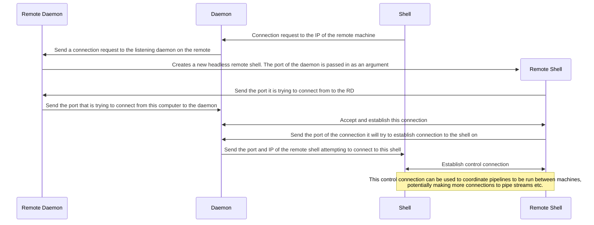

## Direct Network Connections

Both programs bind their IPv4 or IPv6 sockets to the unspecified address, so they
listen on all local interfaces rather than only loopback. They still need a
peer-reachable address to advertise; `0.0.0.0` and `::` are bind addresses, not
addresses to enter on the other machine.

1. Start the controller and enter an IP address the remote can route to, such as
  the controller's LAN or VPN address. The controller prints the control
  address and starts listening before asking for the remote's peer address.
2. Start the remote and enter the controller's printed `IP:port`.
3. After connecting, the remote prints its actual source `IP:port`. Enter that
  full address at the controller so it can verify the peer.
4. Run commands from the controller prompt.

The control connection and each command's stdin, stdout, and stderr use separate
TCP ports. The controller advertises the selected IP with dynamically assigned
ports for those stream listeners. Firewalls must allow those inbound ports.
This works best when the hosts have direct routing, such as on the same LAN or
VPN. NAT generally requires port forwarding for both the control port and the
dynamic stream ports; this implementation does not provide NAT traversal or an
authenticated relay.