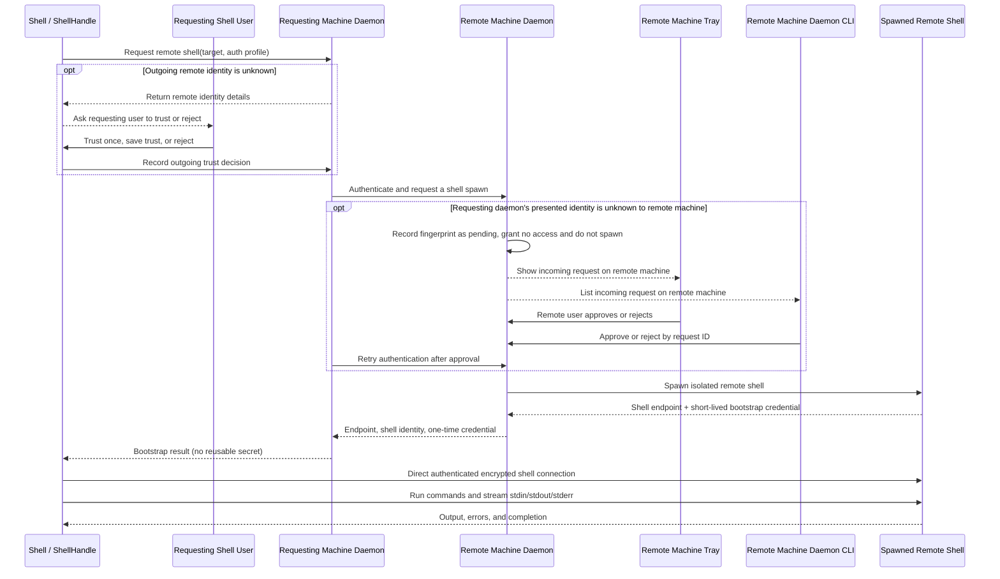
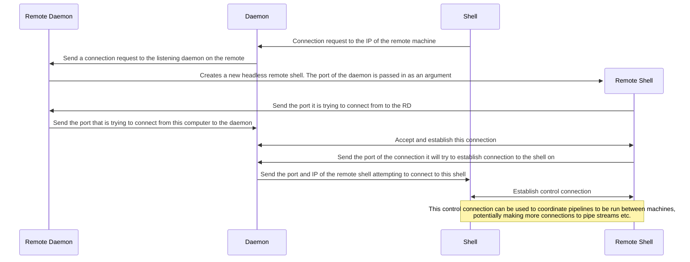

## Proposed daemon-authenticated, ShellHandle-owned remote shells

Each machine runs a per-user daemon. The local daemon handles the initial
authentication/bootstrap with the remote daemon, which then spawns a remote
shell. Once bootstrap succeeds, the local
[`ShellHandle`](crates/shell-core/src/shell.rs#L89) directly connects to and
controls that spawned shell. The handle owns its live remote-shell sessions;
the daemon is not a proxy for command traffic and does not own the long-lived
remote-shell registry.

Outgoing and incoming trust decisions happen on different machines and use
different interfaces. For an **outgoing** connection, the shell command that
requested it shows the remote identity and asks its user whether to trust it.
For an **incoming** connection, the remote machine's daemon marks an unknown
client identity as pending, grants it no access, and does not spawn a shell.
The user on that remote machine can inspect the presented identity/fingerprint
and approve/reject the request in its tray, or from a terminal by running the
daemon CLI there. After approval, the requesting daemon retries
authentication. The tray is optional; the background daemon never needs to
read stdin.

`ShellHandle` keeps the live remote shells in its own registry, keyed by an
opaque `RemoteId`, and routes commands directly to the selected remote shell.
The daemon performs only the initial authenticated request to the remote
daemon and shell spawn. It returns bootstrap information to the requesting
handle, not a live session object or reusable private credential. The tray and
CLI manage authentication and approvals but do not take ownership of active
shell sessions.

Use OS-protected local IPC (for example, user-ACL'd named pipes on Windows or
user-only Unix domain sockets on Unix) for bootstrap requests and daemon
management commands. Authorize local clients and operations; IPC access must
not itself grant remote command execution. Store persistent credentials in an
OS credential store, and keep trust pins/policies separate from login
credentials.

The direct ShellHandle-to-remote-shell connection must itself be encrypted and
authenticated; a successful daemon bootstrap must not imply that arbitrary
connections to the returned endpoint are trusted. A suitable handoff is a
short-lived, single-use capability bound to the spawned shell identity and
expected client, with the remote shell proving its host identity during the
direct russh connection. Do not give the handle reusable daemon credentials.
Carry command control and stdin/stdout/stderr over SSH channels. Reverse
connectivity can be added for network topologies that require it, while
preserving the same trust and authorization checks.

## Current direct-TCP prototype (insecure; migration target)

The headless binaries are still a separate manual controller/remote workflow;
the daemon crate is currently only a stub. The current control connection and
the separate stdin/stdout/stderr sockets do not provide encryption or
cryptographic peer authentication. Do not treat source-IP matching as identity
verification. Replace this workflow with the daemon-owned SSH design above.

### Prototype usage: direct network connections

Both programs bind their IPv4 or IPv6 sockets to the unspecified address, so they
listen on all local interfaces rather than only loopback. They still need a
peer-reachable address to advertise; `0.0.0.0` and `::` are bind addresses, not
addresses to enter on the other machine.

1. Start the controller and enter an IP address the remote can route to, such as
  the controller's LAN or VPN address. The controller prints the control
  address and starts listening before asking for the remote's peer address.
2. Start the remote and enter the controller's printed `IP:port`.
3. After connecting, the remote prints its actual source `IP:port`. Enter that
  full address at the controller so it can compare the observed source address.
  This is not cryptographic peer authentication.
4. Run commands from the controller prompt.

The control connection and each command's stdin, stdout, and stderr use separate
TCP ports. The controller advertises the selected IP with dynamically assigned
ports for those stream listeners. Firewalls must allow those inbound ports.
This works best when the hosts have direct routing, such as on the same LAN or
VPN. NAT generally requires port forwarding for both the control port and the
dynamic stream ports; this implementation does not provide NAT traversal or an
authenticated relay.