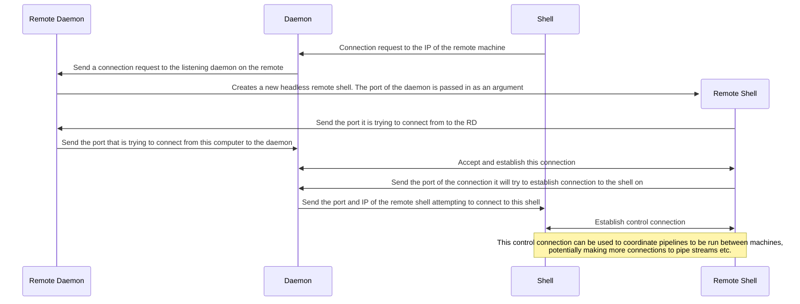

## Direct Network Connections

Both programs bind their IPv4 or IPv6 sockets to the unspecified address, so they
listen on all local interfaces rather than only loopback. They still need a
peer-reachable address to advertise; `0.0.0.0` and `::` are bind addresses, not
addresses to enter on the other machine.

1. Start the controller and enter an IP address the remote can route to, such as
  the controller's LAN or VPN address. The controller prints the control
  address and starts listening before asking for the remote's peer address.
2. Start the remote and enter the controller's printed `IP:port`.
3. After connecting, the remote prints its actual source `IP:port`. Enter that
  full address at the controller so it can verify the peer.
4. Run commands from the controller prompt.

## Mutual TLS

All network connections require mutual TLS: the control connection and each
command's stdin, stdout, and stderr streams. There is no plaintext fallback.
Both machines must use certificates issued by the same trusted CA. The
controller certificate must contain the controller's advertised IP address as
an IP subject alternative name. Both peers need certificates valid for
`clientAuth` and `serverAuth`. A certificate issued by this CA is currently
accepted as a peer; there is no per-certificate allowlist.

With OpenSSL 1.1.1 or newer, create a private CA and a certificate for each
machine. Keep `ca-key.pem` private and do not copy it to either machine:

```sh
openssl req -x509 -newkey rsa:3072 -nodes -keyout ca-key.pem -out ca.pem -days 3650 -subj "/CN=i-shell CA"
openssl req -newkey rsa:3072 -nodes -keyout controller-key.pem -out controller.csr -subj "/CN=i-shell controller" -addext "subjectAltName=IP:192.168.1.10" -addext "extendedKeyUsage=clientAuth,serverAuth"
openssl x509 -req -in controller.csr -CA ca.pem -CAkey ca-key.pem -CAcreateserial -out controller.pem -days 825 -copy_extensions copy
openssl req -newkey rsa:3072 -nodes -keyout remote-key.pem -out remote.csr -subj "/CN=i-shell remote" -addext "extendedKeyUsage=clientAuth,serverAuth"
openssl x509 -req -in remote.csr -CA ca.pem -CAkey ca-key.pem -CAcreateserial -out remote.pem -days 825 -copy_extensions copy
```

Replace `192.168.1.10` with the IP entered as the controller's advertised
address. The `ca.pem` file and each machine's own leaf certificate/key must be
available on that machine. Never copy a private key to the other peer.

Set these environment variables before starting either executable:

- `ISHELL_CA_CERT`: PEM file containing the trusted CA certificate(s).
- `ISHELL_CERT`: this machine's PEM certificate chain.
- `ISHELL_KEY`: this machine's PEM private key.

For example, in PowerShell:

```powershell
$env:ISHELL_CA_CERT = 'C:\i-shell\certs\ca.pem'
$env:ISHELL_CERT = 'C:\i-shell\certs\controller.pem'
$env:ISHELL_KEY = 'C:\i-shell\certs\controller-key.pem'
cargo run -p shell-headless --bin controller
```

Use the remote machine's own certificate and key paths when launching its
remote executable. The shared CA certificate should be distributed to both
machines; private keys should not be copied between them. TLS verification
checks the controller IP against its certificate, so connect using an IP
included in the controller certificate. If certificate verification fails,
check that both peers trust the same CA, the certificate dates are valid, and
the controller certificate's IP SAN matches the address used to connect.

Run the TLS-specific regression tests with `cargo test -p shell-connection
tls::tests`; `cargo test --workspace` runs those along with the rest of the
workspace tests. The TLS tests generate temporary CA and peer certificates and
cover trusted encrypted traffic, IP identity mismatch, and untrusted client or
server certificates.

The control connection and each command's stdin, stdout, and stderr use separate
TCP ports. The controller advertises the selected IP with dynamically assigned
ports for those stream listeners. Firewalls must allow those inbound ports.
This works best when the hosts have direct routing, such as on the same LAN or
VPN. NAT generally requires port forwarding for both the control port and the
dynamic stream ports; this implementation does not provide NAT traversal or an
authenticated relay.