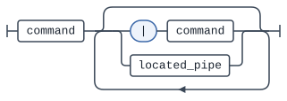
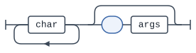
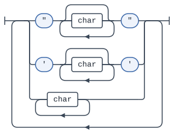
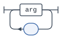
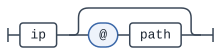

# Grammar

This uses a very simple grammar to parse commands and construct pipes.

## Command

## Arguments

## Location

The location is where the command will be executed. It can be a directory and/or Ip. If it is an Ip
a connection will attempt to be established if there does not already exist one.
